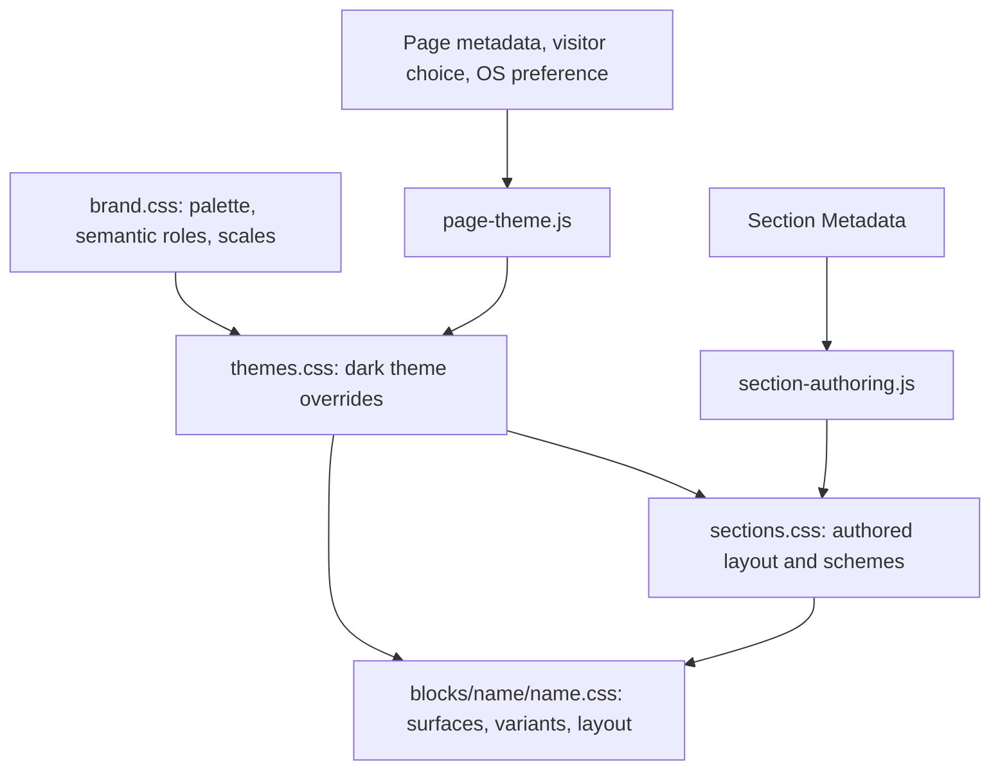

# Everything Energy style system

This guide explains how styling works in this repository: how values reach the page, which files own each responsibility, and how to author or extend the system. It describes the current code. It covers Everything Energy's blocks and its light and dark themes.

For authoring, start with [page themes](#page-themes-light-and-dark) and [section controls](#authoring-sections-in-da). For development, start with the [repository map](#repository-map) and [change guidance](#making-a-change).

## Contents

- [How the layers fit together](#how-the-layers-fit-together)
- [Repository map](#repository-map)
- [Tokens and naming](#tokens-and-naming)
- [Page themes: light and dark](#page-themes-light-and-dark)
- [Authoring sections in DA](#authoring-sections-in-da)
- [Surfaces own their foregrounds](#surfaces-own-their-foregrounds)
- [How the page loads](#how-the-page-loads)
- [Making a change](#making-a-change)
- [Troubleshooting](#troubleshooting)
- [Validation](#validation)

## How the layers fit together

A palette value identifies a color. A semantic token describes its purpose. A page theme can change that semantic value. A section chooses an inherited color scheme and outer layout. A block consumes these values and owns its internal presentation.

For example, `--palette-navy-900` is `#131631`. In the light theme, `--color-text-primary` maps to it, and every block title uses that role. The dark theme maps `--color-text-primary` to `--palette-slate-50` (`#f3f3f8`), so the same titles turn light without any block changing. A section authored with `Color Scheme: dark` uses the inverse surface and inverse text. A plan card inside that section keeps its own raised surface and matching text.



This diagram shows responsibilities. It is not a CSS priority ladder: normal inheritance, selector specificity and source order still decide the result. A block that paints its own surface must also supply readable foregrounds for that surface.

## Repository map

| File | Responsibility | Change it when… |
| --- | --- | --- |
| [`styles/brand.css`](../styles/brand.css) | Palette, semantic roles, typography and spacing scales, layout, radii, shadows, motion, layers, and `--ee-*` aliases | A reusable design value or role needs to change across the site |
| [`styles/themes.css`](../styles/themes.css) | Dark theme overrides on `:root[data-page-theme="dark"]` | The dark theme needs a different value for a role |
| [`styles/styles.css`](../styles/styles.css) | Imports, EDS variable aliases, inherited foreground hooks, base elements, default section spacing | A base or page-wide default needs to change |
| [`styles/sections.css`](../styles/sections.css) | Legacy `light`/`highlight` section styles, authored containers, grids, spacing, schemes and backgrounds | A Section Metadata option needs a shared visual behavior |
| [`styles/zip-form.css`](../styles/zip-form.css) | ZIP card and ZIP search shared by several blocks | The shared ZIP form changes |
| `blocks/{name}/{name}.css`, `templates/{name}/{name}.css` | The block or template's surface, internal layout, variants and responsive rules | A change belongs to one block or template |
| [`scripts/page-theme.js`](../scripts/page-theme.js) | Theme resolution, the visitor's saved choice, the root `data-page-theme` attribute | Theme selection behavior changes |
| [`scripts/section-authoring.js`](../scripts/section-authoring.js) | Turns Section Metadata into section attributes, variables and backgrounds | Section authoring options or parsing change |
| [`scripts/scripts.js`](../scripts/scripts.js) | Runs theme selection and section authoring in the page lifecycle | A shared behavior needs to join page loading |
| [`blocks/header/header.js`](../blocks/header/header.js) | Builds the dark mode switch in the menu | The switch's markup or placement changes |

## Tokens and naming

Tokens are ordinary CSS custom properties. There is no token compiler, generated stylesheet or build step.

| Family | Examples | Use |
| --- | --- | --- |
| Palette | `--palette-purple-500`, `--palette-navy-950` | Base color values. Blocks normally use a semantic role instead |
| Semantic colors | `--color-text-primary`, `--color-surface-raised`, `--color-link-hover` | Purpose-based colors for text, surfaces, borders, links, actions, accents, focus and status |
| Gradients | `--gradient-accent-rule`, `--gradient-accent-band`, `--gradient-brand` | Recurring brand gradients |
| Shadow inks and elevations | `--color-shadow-ink`, `--shadow-card`, `--shadow-panel` | Shadow colors that themes can change, plus recurring shadows |
| Typography | `--font-family-body`, `--font-weight-bold`, `--font-size-18`, `--text-heading-1-size` | Families, weights, sizes and text roles |
| Spacing and layout | `--space-24`, `--spacing-l`, `--layout-container-max` | Spacing scale, author-facing names, page bounds and gutters |
| Shape, motion, layers | `--radius-card`, `--motion-duration-normal`, `--layer-header` | Corners, timing (zero under reduced motion), stacking order |
| Theme switches | `--logo-color-display`, `--logo-white-display`, `--logo-plate-padding` | Values a theme flips for bundled logos and third-party logo plates |
| Inherited hooks | `--heading-color`, `--text-color`, `--link-color`, `--link-hover-color` | Foregrounds consumed by base elements. Sections and owned surfaces rebind them |
| Compatibility | `--ee-*`, `--background-color`, `--heading-font-size-*` | Earlier names, mapped onto the foundation |

### Semantic color roles

| Role | Light | Dark | Used for |
| --- | --- | --- | --- |
| `--color-text-primary` | navy `#131631` | `#f3f3f8` | Titles, labels, input text |
| `--color-text-secondary` | slate `#5b5c69` | `#c3c5d4` | Body copy |
| `--color-surface-default` | white | `#0e1024` | The page |
| `--color-surface-raised` | white | `#1e2242` | Cards, popovers, the menu flyout |
| `--color-surface-subtle` | `#f8f8f8` | `#181b37` | Tinted bands (formerly `--ee-cards-bg`) |
| `--color-surface-muted` | `#f2f2f2` | `#262a4d` | Input pills, tags, the footer |
| `--color-surface-inverse` | navy `#131631` | `#080a1a` | Dark-scheme sections |
| `--color-link` / `-hover` | purple / pink | light purple / light pink | Default links |
| `--color-link-accent` / `-hover` | pink / purple | light pink / light purple | Article and FAQ links |
| `--color-action-primary` / `-hover` | purple / pink | unchanged | Pill buttons, back pills |
| `--color-accent` | pink `#d8479a` | `#e46aa9` | Title bars, eyebrow labels, provider names |
| `--color-accent-strong` | purple `#7564c1` | `#a596e8` | Rates, icon buttons, tip titles |
| `--color-surface-logo` | white | white | Plates behind third-party logos (stay light) |

Prefer a semantic role over a palette value in block rules. Add a palette shade only when it is needed, and give it a semantic role when several consumers share the same purpose. Artwork, such as the FAQ category gradients, the review quote marks and the ZIP call-to-action band, uses palette tokens directly because it does not change with the theme.

During the migration, three near-duplicate shades were merged into their neighbors: `#d84699` into `#d8479a`, `#745ac0` into `#7564c1`, and the blog card's `#f4f4f4` into `#f2f2f2`.

### Units

Font-size and spacing suffixes are pixel equivalents at the browser's default 16px root size, so `--font-size-16` and `--space-16` are `1rem`. The root font size stays unset so rem values follow browser preferences. Global styles use these tokens. Block stylesheets keep their existing pixel measurements, which preserve the reference layouts, and can move to the scales over time.

## Page themes: light and dark

The current look is the **light** theme, defined in `brand.css`. The **dark** theme in `themes.css` overrides semantic roles only. `scripts/page-theme.js` sets `<html data-page-theme="light">` or `"dark"` before the first section is shown, so there is no flash of the wrong theme.

The first source that gives an answer wins:

1. Page Metadata `Theme: light` or `dark`. This pins the page to one theme, for example when its artwork only works on a light background. The dark mode switch is hidden on pinned pages.
2. The visitor's choice from the **Dark mode** switch in the header menu, saved in `localStorage` (`ee-page-theme`).
3. The operating system's `prefers-color-scheme`. Until the visitor chooses, the page follows live OS changes.
4. Otherwise, light.

Theme values are case insensitive, `theme-dark` is also accepted, and in a comma-separated value the first recognized theme wins.

| Metadata | |
| --- | --- |
| Theme | light |

**What changes in dark mode:** text, surfaces, borders, links, accents, focus, shadow inks and native controls (`color-scheme: dark`). The header and footer switch to `icons/logo-white.svg`. Third-party provider logos sit on light plates.

**What stays the same:** brand artwork and anything painted on it, including the ZIP hero photo and swoosh, the personalization gradient, the plan explorer band, the FAQ category tiles, the review quote colors and the gradient rules. Primary buttons keep the brand purple with a pink hover. Authored images are never replaced.

To make the site light-only by default, change `getPageTheme()` in `page-theme.js` so it no longer consults `prefers-color-scheme`. Visitors can still opt in with the switch.

## Authoring sections in DA

Put a **Section Metadata** table in the section to configure. Omitted options keep the existing page and block layout.

| Section Metadata | |
| --- | --- |
| Container | standard |
| Grid | 3 |
| Gap | m |
| Spacing | l |
| Color Scheme | dark |
| Align | center |
| Anchor | featured-plans |

This example creates a standard-width section with three whole blocks per row on large screens, an inverse surface, centered default content and a deep-link ID. Its blocks keep their own surfaces and internal layouts.

| Field | Supported values | Result |
| --- | --- | --- |
| Container | `narrow`, `standard`, `full` | 800px maximum, 1200px maximum, or full width without side gutters |
| Grid | `1`–`6` | Whole blocks stack below 768px, use up to two columns from 768px, and use the selected count from 1200px |
| Gap | `none`, `xs`, `s`, `m`, `l`, `xl`, `xxl` | Space between grid cells (0, 4, 8, 12, 24, 32, 48px) |
| Spacing | The same names | Equal top and bottom padding (0, 8, 16, 24, 48, 64, 96px) |
| Color Scheme | `light`, `dark` | Light uses the page theme's default roles; dark uses the inverse roles |
| Background | `default`, `subtle`, `muted`, `highlight`, `inverse`, `inverse-raised`; a `--color-*`, `--palette-*` or `--gradient-*` token; a CSS color or gradient; or an image | The section background |
| Background Color / Background Image | Separate fields | A base color with decorative imagery |
| Align | `left`, `center`, `right` | Alignment of default content |
| Anchor / ID | An ID, optionally starting with `#`, without spaces | Deep-link target |
| Style | Existing styles, plus aliases such as `container-narrow`, `grid-3`, `gap-m`, `spacing-l`, `dark-scheme`, `center` | Style-based authoring |

Named backgrounds choose a matching scheme unless Color Scheme is set. For a custom color, gradient or image, set Color Scheme explicitly so the text stays readable. Background images are decorative and get empty alt text; meaningful images belong in block content.

The existing `Style: light` and `Style: highlight` sections keep their tinted band, now using `--color-surface-subtle`, so they follow the theme. Once a section uses any authored option, those legacy rules step aside and the authored options control the section.

### How metadata maps into the DOM

`aem.js` reads the table into `data-*` attributes and removes it. `section-authoring.js` then converts those attributes, without changing `aem.js`:

```html
<div class="section"
     data-section-layout="authored"
     data-section-container="standard"
     data-section-grid="3"
     data-section-gap="m"
     data-section-spacing="l"
     data-section-theme="dark"
     data-section-align="center"
     id="featured-plans"
     style="--section-grid-count: 3;">
```

Missing cells and unsupported values are ignored. `Anchor` alone sets an ID without opting into the authored layout.

## Surfaces own their foregrounds

Base elements in `styles.css` read inherited hooks: headings use `--heading-color`, paragraphs and lists use `--text-color`, and links use `--link-color` and `--link-hover-color`. A section scheme rebinds those hooks, so default content follows the section.

A block that paints its own surface binds the hooks that suit it, so inherited section colors cannot make its text unreadable. These include the ZIP card, the provider list cards, the fetch-plans card, the blog-post ZIP card, the plan explorer widget, and the brand-gradient blocks (personalization, plan explorer copy).

```css
.example-card {
  --heading-color: var(--color-text-primary);
  --text-color: var(--color-text-secondary);
  --link-color: var(--color-link);
  --link-hover-color: var(--color-link-hover);

  border-radius: var(--radius-card);
  background: var(--color-surface-raised);
  box-shadow: var(--shadow-card);
  color: var(--text-color);
}
```

Use `--color-surface-raised` for cards and popovers, not `--color-surface-default`. The two are identical in light mode, but in dark mode a raised card must be lighter than the page. Content on brand artwork uses `--color-text-on-accent`, which stays white in both themes.

CSS custom properties resolve on the element where they are declared. Derived roles in `brand.css` (header, footer, shadows, `--ee-*`) follow the dark theme because the theme overrides the base roles on the same root element.

## How the page loads

1. `styles/styles.css` imports `brand.css`, `themes.css` and `sections.css`, in that order, before its base rules.
2. In `loadEager`, `decorateTemplateAndTheme()` runs, then `decoratePageTheme()` sets `data-page-theme` on `<html>`, while the body is still hidden.
3. `decorateMain()` decorates icons and image links, builds auto blocks, creates sections, runs `decorateSectionAuthoring()`, then decorates blocks and buttons.
4. The first section loads before the body becomes visible. The header (with the switch) and the footer load lazily.

Fragments use the same `decorateMain()` pipeline, so their sections accept the same options and inherit the page theme.

## Making a change

| Requested change | Owner |
| --- | --- |
| Change a color used for the same purpose everywhere | The semantic role in `brand.css` |
| Change that role only in dark mode | The override in `themes.css` |
| Add a shade | A palette token in `brand.css`, then a role if more than one consumer needs it |
| Change shared section grid, spacing or scheme options | `sections.css`, and `section-authoring.js` if the authoring contract changes |
| Change one block's colors or layout | That block's stylesheet, using semantic roles |
| Change how the theme is chosen | `page-theme.js` |
| Pin one page to light or dark | Page Metadata `Theme` in DA |

### Adding a block

Use semantic roles only, not hex values. Choose the surface first (transparent, `raised`, `subtle` or `muted`), and if the block paints one, bind the foreground hooks as shown above. Avoid `#fff` for card backgrounds: use `--color-surface-raised`. For third-party logos, apply `padding: var(--logo-plate-padding)`, `border-radius: var(--logo-plate-radius)` and `background: var(--color-surface-logo)`. In light mode these add nothing visible; in dark mode they add a light plate.

Then check the block in both themes, and inside a `Color Scheme: dark` section.

### Adding a theme

Add a selector for the new theme in `themes.css` that overrides semantic roles, add its name to `THEMES` in `page-theme.js`, and review focus, actions, native controls, logos and aliases together. Adding a CSS selector alone does not make a new Metadata value recognized.

## Troubleshooting

| Symptom | Check |
| --- | --- |
| A block stays light in dark mode | It uses a hex value, a palette token or `--color-surface-default` for a card. Switch to the semantic role (`--color-surface-raised` for cards) |
| White text on a white card inside a dark section | The card relies on inherited hooks. Bind `--heading-color`, `--text-color` and the link hooks on the card |
| The dark mode switch is missing | The page has Metadata `Theme`, which pins it |
| The page ignores the OS setting | The visitor has a saved choice. Clear `ee-page-theme` from `localStorage` |
| Section Metadata changed spacing unexpectedly | The section is now authored, so legacy rules step aside. Set Container and Spacing explicitly |
| A logo disappears in dark mode | Use the logo plate tokens, or for bundled logos, the `--logo-*-display` tokens |

## Validation

Run `npm run lint`. There is no automated browser suite. When this system was introduced, it was verified against the previous code with headless Chrome:

- In light mode, `/en/plans`, `/en/faqs` and `/en/faqs/power-outages` rendered byte-identical to the previous code. `/en/` differed by at most 2/255 per channel (rounding). `/en/providers/` differed only by the merged `#745ac0` accent bar.
- In dark mode, `/en/`, `/en/plans`, `/en/providers/` and `/en/faqs/power-outages` were reviewed visually.
- Theme resolution was tested end to end: OS preference, a live OS change, saving and reloading a visitor choice, a pinned page hiding the switch, and the switch's place in the menu's focus order.
- Section options were tested end to end: the scheme, container, grid, gap, spacing, align, anchor and named, token and gradient backgrounds, with the metadata tables removed.

For a change, review both themes, an authored dark section, block-owned surfaces, mobile and desktop widths, keyboard focus and 200% text.
